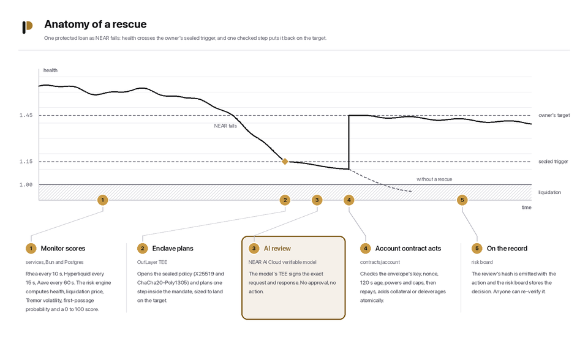
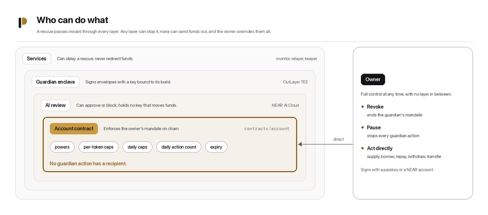
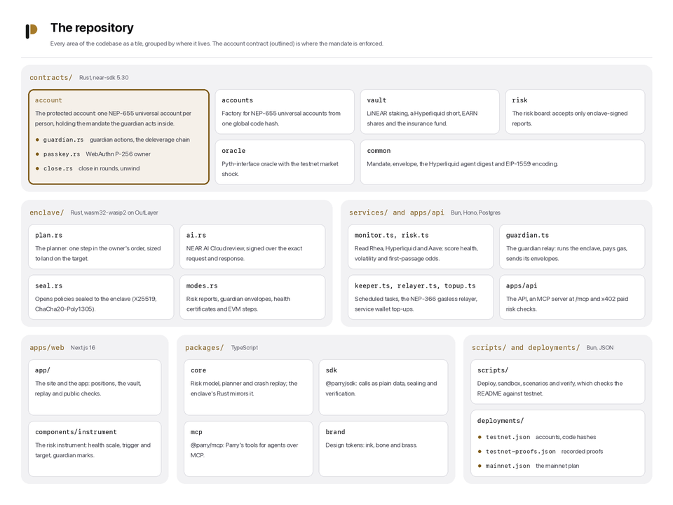

<div align="center">

<picture>
  <source media="(prefers-color-scheme: dark)" srcset="assets/readme/hero-dark.png">
  <source media="(prefers-color-scheme: light)" srcset="assets/readme/hero-light.png">
  
</picture>

<h3>Your leverage, defended before the liquidator gets there.</h3>

<p>
  <a href="https://parry.market/app"></a>
  <a href="MAINNET.md"></a>
  <a href="JUDGES.md#technical-implementation"></a>
  <a href="JUDGES.md#technical-implementation"></a>
  <a href="SECURITY.md"></a>
  <a href="https://www.npmjs.com/package/@parryguard/sdk"></a>
  <a href="https://www.npmjs.com/package/@parryguard/mcp"></a>
  <a href="LICENSE"></a>
</p>
<p>
  
  
  
  
  
  
</p>

<!-- links:start -->
<p align="center">
  <a href="https://parry.market/app"><b>Open the app</b></a> · <a href="https://api.parry.market/v1/status">API status</a> · <a href="#use-it-from-an-agent">MCP server</a> · <a href="https://parry.market/llms.txt">llms.txt</a> · <a href="https://parry.market/verify">Verify a decision</a>
</p>
<!-- links:end -->

</div>

---

Parry keeps leveraged positions from being liquidated, and runs a delta-neutral NEAR vault.
A guardian in an OutLayer TEE watches each protected position, plans a rescue, has a NEAR AI Cloud verifiable model review it, and signs it with a key bound to its build.
The person's account contract accepts only protective actions within their on-chain mandate, and records the hash of the review that approved each one.

> [!TIP]
> **Live on NEAR testnet, ready for mainnet.** Every contract, the enclave and the services switch networks with one setting, against the live mainnet protocols; the plan, the rehearsal and the costs are in [`MAINNET.md`](MAINNET.md).

<table>
<tr>
<td width="25%" valign="top">

**Protect**<br>
A guardian that repays, adds collateral or deleverages before liquidation, only inside your mandate.

</td>
<td width="25%" valign="top">

**Prove**<br>
Every action carries a verifiable AI review; private health certificates prove "health is at least X".

</td>
<td width="25%" valign="top">

**Earn**<br>
A delta-neutral vault: staked NEAR plus a Hyperliquid short, with proof of reserves on chain.

</td>
<td width="25%" valign="top">

**Watch**<br>
Any NEAR account's liquidation risk, free for people and paid per call for agents over x402.

</td>
</tr>
</table>

<p align="center">
  <a href="#try-it-in-two-minutes">Try it</a> ·
  <a href="#what-parry-does">What it does</a> ·
  <a href="#replayed-through-nears-worst-crashes">Crash replay</a> ·
  <a href="#how-a-rescue-happens">How a rescue happens</a> ·
  <a href="#the-guardians-scope">Guardian scope</a> ·
  <a href="#only-on-near">Only on NEAR</a> ·
  <a href="#deployed-contracts">Contracts</a> ·
  <a href="#run-it-yourself">Run it</a> ·
  <a href="#use-it-from-code">SDK</a> ·
  <a href="#use-it-from-an-agent">MCP</a>
</p>

---

## Try it in two minutes

| Step | Where | What happens |
| :---: | --- | --- |
| **1** | Connect | Sign in with a passkey, or a NEAR testnet wallet through NEAR Connect. The relayer creates your protected account; you pay no gas. |
| **2** | **Open position** | Supply test NEAR, borrow test USDC, take a USDC reserve from the faucet. You see health, liquidation price and time to liquidation. |
| **3** | **Protect** | Set a mandate: let the guardian repay from the reserve, up to a daily cap, for a week. Your trigger and target are sealed to the enclave before they leave the browser. |
| **4** | **Market shock** | Drop NEAR by 20 % on the testnet oracle. Within a minute the dashboard turns critical and an alert arrives. |
| **5** | **Guardian** | The rescue appears with its plan, the model's verdict and its transactions. **Verify** checks the review's signature, its hash on chain and the enclave's signature in front of you. |
| **6** | **Vault** | Health is back above the target. Deposit test NEAR and see the hedge, the insurance fund, the share price history and the proof of reserves. |
| **7** | **Close** | **Close the position** sells collateral in rounds that each keep health above 1 (or repays from your wallet), and **Unwind the account** takes everything back. |

No account needed for **Check** (any NEAR account's risk at [`/check`](https://parry.market/check)), **Verify** (any decision, certificate or transaction at [`/verify`](https://parry.market/verify)) and **Replay** (Parry through NEAR's worst crashes at [`/replay`](https://parry.market/replay)).

## Built for four tracks

| Track | What Parry brings |
| --- | --- |
| **DeFi** | Liquidation protection for Rhea lending, Hyperliquid perps and Aave, plus a delta-neutral vault with an on-chain risk score and proof of reserves. |
| **Agent Economy** | An MCP server with read tools and capped write tools, risk checks paid per call over x402 on NEAR, an agent skill, `llms.txt`, and a NEAR Agent Market listing that answers hires. |
| **AI Security** | The AI approves or blocks; it never holds a key that moves funds. Its review is bound to the exact bytes by the model's TEE signature, and the account contract enforces the mandate whatever any service or model says. |
| **Privacy** | Trigger thresholds, strategy and step order are sealed to the enclave's key, so nobody watching the chain learns when a position will be defended; private health certificates prove "health is at least X" to one named reader without revealing any amount; rescue swaps compare against NEAR Intents' confidential routes. |

## What Parry does

### Protect

A protected account is your own NEAR smart account, owned by a passkey or a NEAR account.
It holds a Rhea lending position, and can also hold a Hyperliquid perp and an Aave loan on Base through Chain Signatures.
You give the guardian a mandate: the powers it has (repay from a reserve, add collateral, deleverage, reduce or hedge the perp, repay the Aave loan), how much of each token it may use in total and per day, how many actions a day, and when the mandate ends.
Your trigger and target, and the order the guardian tries its steps in, are sealed to the guardian's enclave, so nobody watching the chain learns when your position will be defended.
The guardian takes the first step you allow that moves health, sizes it to land on your target, checks again after each step, and writes down why it chose that step.
You can close a position or unwind the whole account yourself at any time; each round is all or nothing.

### Prove

The enclave signs private health certificates: "health is at least X" for one named reader, at one block, until an expiry, with no amounts.
You can anchor a certificate's hash on the risk board, and anyone can check it on `/verify`, in the SDK or over MCP.

### Earn

The vault stakes NEAR into LiNEAR and shorts the NEAR perp on Hyperliquid with an order the vault itself builds and Chain Signatures signs, so its value follows dollars plus staking yield and funding.
Shares are the NEP-141 token `EARN`, valued at net asset value; withdrawals go through a queue and pay out in kind.
The enclave publishes the vault's risk score and a proof-of-reserves Merkle root on chain, and the vault pauses deposits when the risk is high.
The hedge ratio follows funding within its bounds, and the hedge's margin is topped up before it runs low.
The vault's one fee: 10 % of positive yield goes into an insurance fund that pays only for negative funding streaks, hedge slippage beyond the band and margin top-ups, under per-payout and per-day caps.

### Watch

Anyone can check any NEAR account's lending risk without signing up: health, liquidation price, the probability of liquidation within 24 hours, the median time to it, and a 0 to 100 score.
Watch any accounts with your own thresholds, see where Rhea borrowers would be liquidated on the cascade map (read from the lending contract on mainnet and testnet), and follow rates, funding and prices live.
Agents pay per check over x402 on NEAR, or use the MCP server.

## Replayed through NEAR's worst crashes

Six real NEAR crashes, hour by hour from Binance's public candles, run through Parry's risk model, a guardian and the vault (`pnpm replay`; results with every source in [`deployments/replay.json`](deployments/replay.json)).

| Crash | Drop | Liquidated without Parry | Warning | Guardian steps | Min health with Parry | Vault drawdown (unhedged) | Min margin ratio | Insurance paid |
| --- | ---: | --- | ---: | ---: | ---: | ---: | ---: | ---: |
| 21 Dec 2020 to 24 Dec 2020 | 39.8 % | 2020-12-21 10:00 | 7 h | 7 | 1.080 | 2.7 % (39.8 %) | 0.500 | $0.00 |
| 21 May 2021 to 23 May 2021 | 45.6 % | 2021-05-21 14:00 | 10 h | 9 | 1.236 | 3.1 % (45.6 %) | 0.500 | $0.00 |
| 19 Jan 2022 to 22 Jan 2022 | 39.1 % | 2022-01-21 20:00 | 47 h | 7 | 1.193 | 2.7 % (39.1 %) | 0.500 | $5.49 |
| 9 May 2022 to 12 May 2022 | 51.7 % | 2022-05-11 06:00 | 44 h | 7 | 0.971 (liquidated) | 3.8 % (51.7 %) | 0.500 | $5.07 |
| 31 Jan 2025 to 3 Feb 2025 | 38.6 % | 2025-02-02 18:00 | 33 h | 6 | 1.149 | 2.6 % (38.6 %) | 0.500 | $2.93 |
| 3 Jun 2026 to 6 Jun 2026 | 38.9 % | 2026-06-04 08:00 | 16 h | 6 | 1.240 | 2.7 % (39.4 %) | 0.500 | $0.68 |

| Warned before every liquidation | Liquidations avoided | Worst hedged vault drawdown |
| :---: | :---: | :---: |
| **24.5 h** median, 7 h at the shortest | **5 of 6** | **under 4 %** against up to 51.7 % unhedged |

The sixth crash was a single-hour 32 % wick that arrived after the owner's daily action budget was spent; a higher target or a larger daily budget, both owner settings, covers it.

## How a rescue happens



1. **Watch.** The monitor reads each position (Rhea every 10 seconds, Hyperliquid every 15, Aave every 60); the risk engine scores it with the model in [`docs/risk-model.md`](docs/risk-model.md).
2. **Plan.** At caution or worse, or under health 1.5 (the highest trigger an owner may seal), the guardian runs in the OutLayer TEE: it opens the sealed policy, plans one step inside the mandate, and asks a NEAR AI Cloud verifiable model to review it.
3. **Review.** The model's TEE signs the exact request and response; the enclave checks that signature and signs an envelope with its own key, which OutLayer derives from the enclave's build.
4. **Act.** The account contract checks the envelope's key, nonce, age, powers and caps, acts, and emits the review's hash with the action; the risk board records the decision.
5. **Verify.** Anyone can re-check a decision: the app's **Verify**, `parry.verifyDecision` in the SDK, `verify_guardian_decision` in the MCP server, and `pnpm verify`.

## The guardian's scope



| | |
| --- | --- |
| **Acts on** | Repay debt from your reserve, add collateral from your reserve, sell some collateral through the exchange to repay (restoring everything if any step fails), reduce or hedge your perp inside a size cap and a price band, approve or repay your Aave loan for your own address. |
| **Bounded by** | Your mandate: its powers, each token's total and daily caps, the daily action count and the expiry; and a fresh envelope (120 seconds) at the next nonce. |
| **Gated by** | An approving review whose TEE signature verifies; no review, no action. |
| **Pays out to** | Nobody. No guardian action has a recipient, so funds never leave your account through it. |
| **Answers to** | You: revoke the mandate, pause the guardian or act directly at any time. |

### Privacy by design

| Sealed to the enclave | Public on chain | Seen by the review model, inside its TEE |
| --- | --- | --- |
| Your trigger thresholds, target health and strategy (X25519 and ChaCha20-Poly1305 to the enclave's key, bound to your account id) | Your positions, your mandate's powers and caps, and every action the guardian takes | The facts of one decision: the position, the plan, the mandate and the owner's trigger. The verdict and reasoning show in the guardian log; on chain there is only the review's hash. |

## Only on NEAR

Each row is a NEAR primitive Parry depends on, the code that uses it, and a testnet transaction that shows it working (filled by `bun scripts/readme.ts` from `deployments/testnet-proofs.json`).

<!-- proofs:start -->
| Primitive | What Parry does with it | Code | On testnet |
| --- | --- | --- | --- |
| NEP-655 universal accounts and global contracts | every protected account is derived from one published code hash and created by the relayer | [`accounts/src/lib.rs`](contracts/accounts/src/lib.rs) | [transaction](https://testnet.nearblocks.io/txns/FYxvwqXmG7E84ifKZB4hQFNh7LEAuUfenaE7nrkjwyzL) |
| Chain Signatures | a protected account signs its Hyperliquid orders, its Spot-to-Perps margin moves and its Aave repay, and the vault its hedge, each for its own derived address | [`hyperliquid.rs`](contracts/common/src/hyperliquid.rs), [`evm.rs`](contracts/common/src/evm.rs) | [account's Hyperliquid order](https://testnet.nearblocks.io/txns/HVJyZvz2rmKfPJ1ztYGx3PtA3x1T68fhAaKWcAbvV7bG), [its margin move](https://testnet.nearblocks.io/txns/Dpg9QdydvGhKFcpSGQxa2jsTzjksxEoB4UvyrLF8jEQX), [vault hedge](https://testnet.nearblocks.io/txns/C5mPs3JNRwq2D2jChJUVBfat1nX29nWnhthdXuBiZGY5), [Aave repay](https://testnet.nearblocks.io/txns/76HZsxGy3bW2ZS8eEbmYkT8R85hg6pvsgvkGby7eF3kw) |
| MPC foreign-transaction verification | the MPC network confirms the Aave repay landed on Base Sepolia | [`services/src/lib/evm.ts`](services/src/lib/evm.ts) | [transaction](https://testnet.nearblocks.io/txns/6QH7NDnskgmdmcCaonV3GXQHSFcFTDJuowSXz6chKA4a) |
| OutLayer TEE | the guardian runs with keys bound to its build | [`enclave/`](enclave) | [keys run](https://testnet.nearblocks.io/txns/7ENXHN7EFgSyP4rTcBSY88AqpuyZoMskNFmeRskB8A31) |
| NEAR AI Cloud verifiable models | every rescue is reviewed, and the review's TEE signature is checked before acting | [`enclave/src/ai.rs`](enclave/src/ai.rs) | [AI-reviewed rescue](https://testnet.nearblocks.io/txns/Hnwb9p1y8V5Ajxh2kEgWeNdz1qhb5i9BYLcwUD7VqHPS) |
| Rhea lending and exchange | positions, repays and the atomic deleverage, on lending's exact mainnet code | [`guardian.rs`](contracts/account/src/guardian.rs) | [supply](https://testnet.nearblocks.io/txns/HesapwfgHxDRXfQZGq6JwMRw9q3YZnRTFqfFp58e6tVw), [borrow](https://testnet.nearblocks.io/txns/DPyQ9RUwNUBdm7V6y58J2hBmGZyYcgWFyyEKf6mDp1Ty), [guardian repay](https://testnet.nearblocks.io/txns/Hnwb9p1y8V5Ajxh2kEgWeNdz1qhb5i9BYLcwUD7VqHPS), [deleverage](https://testnet.nearblocks.io/txns/54XMKdDUu6dV7ErFg8Pv4pEdS98BfALbBGq9N3LtNGtZ) |
| x402 on NEAR | paid risk checks settled with a signed delegate `ft_transfer` | [`apps/api/src/x402.ts`](apps/api/src/x402.ts) | [transaction](https://testnet.nearblocks.io/txns/ETZ1TFMQAHRwnkEdC9QAdWJHVhEMxYYi8FBRWLy2UyqT) |
| Gas keys (NEP-611) | each service signs on a prepaid gas key with parallel nonce lanes, and refills it itself | [`near.ts`](services/src/lib/near.ts) | [keeper, 8 lanes](https://testnet.nearblocks.io/txns/ForLagMhcnjao6PzVgkRQQBaEpxo7iJ9bfcNXisUa3K1), [monitor, 4 lanes](https://testnet.nearblocks.io/txns/C4GFLKTB9Tkd6gU6eWjD6z5EHVsnBe4DA1iMvn8mTSHC), [relayer, 8 lanes](https://testnet.nearblocks.io/txns/7X4kzrKobrNoqZobrSG9JqDt2C4bNo1JvB16tZR3DtWp) |
| Post-quantum keys (ML-DSA-65) | the treasury, which holds the most NEAR, signs with an ML-DSA-65 key | [`deploy.ts`](scripts/deploy.ts), [`topup.ts`](services/src/topup.ts) | [key added](https://testnet.nearblocks.io/txns/CK3M4AqawEHZg7WVBNEK75DNVCUhzSLpnE33ZQm3MtDs), [a top-up it signed](https://testnet.nearblocks.io/txns/GwzViNzy9SjomAKq9MLdBC7hH5Qjx7XXnbFfGZ7fAQ9D) |
<!-- proofs:end -->

<details>
<summary><b>Parry also uses</b></summary>

- passkeys verified on chain ([`passkey.rs`](contracts/account/src/passkey.rs)) and NEAR Connect wallets, with NEP-413 sign-in;
- NEP-366 meta transactions through its relayer ([`relayer.ts`](services/src/relayer.ts));
- NEAR AI's inference SDK to verify the review model's Intel TDX and NVIDIA GPU attestation ([`verify.ts`](apps/api/src/verify.ts));
- NEAR Intents: 1Click dry-run quotes for every rescue swap and for the vault's Hyperliquid margin ([`routes.ts`](services/src/lib/routes.ts)), and on mainnet a confidential rescue reserve on the Intents Agent API ([`intents.ts`](services/src/lib/intents.ts));
- NEAR's Agent Market, where a listing answers hires with risk reports ([`market.ts`](services/src/market.ts)).

</details>

## Deployed contracts

Live on testnet, with the mainnet deployment planned account by account in [`deployments/mainnet.json`](deployments/mainnet.json).
Every contract is a reproducible build in SourceScan's pinned image (`contracts/scripts/build.sh --reproducible`), and `near contract verify deployed-at <account>` rebuilds it and matches the deployed code.

<!-- contracts:start -->
| Contract | Account | Code hash | Deployed in | Reproducible build |
| --- | --- | --- | --- | --- |
| Factory for protected accounts (NEP-655 universal accounts) | [`accounts.parry.testnet`](https://testnet.nearblocks.io/address/accounts.parry.testnet) | `AA6Q9HqLHPW2HntmojLjwtVsZM1CgSRXDQt5prVidtd3` | [CVgpZJCS...](https://testnet.nearblocks.io/txns/CVgpZJCSbEzF5U4AYQoAjqR8QczUm2BUp9uapPMs7CM9) | matched by `near contract verify` (2026-11-12) |
| Protected-account code, published by hash (global contract) | global code | `2gpDT76rPg2dtQ33GsXzQL5KU9Qfyz7hrjbFbF4Ajcht` | [6AoEjdXk...](https://testnet.nearblocks.io/txns/6AoEjdXk7ak5FERHk83MiL6siKNedhC353GDHnQbna8Y) | matched by `near contract verify` (2026-11-13) |
| Risk board: enclave-signed scores, marks, decisions and the sealing key | [`risk.parry.testnet`](https://testnet.nearblocks.io/address/risk.parry.testnet) | `CVAPjUAokGUcXVRsGnZGxdCpLJ7ajxbevopzfugP5v3W` | [3uuBK1iY...](https://testnet.nearblocks.io/txns/3uuBK1iYs1s2APsZYiPaMudtoh26JEqW369kjxcNzX1m) | matched by `near contract verify` (2026-11-12) |
| Delta-neutral vault, `EARN` shares | [`vault.parry.testnet`](https://testnet.nearblocks.io/address/vault.parry.testnet) | `Gj8z4eLnFjNZgpes5D5PP4U5dT17YYJE29hhsBEAMoKo` | [BvzMYzAu...](https://testnet.nearblocks.io/txns/BvzMYzAu4kHBrGifwZwqJcz98GBcMCEhptHaAwuPFaGS) | matched by `near contract verify` (2026-11-13) |
| Pyth-interface price oracle with the testnet market shock | [`oracle.parry.testnet`](https://testnet.nearblocks.io/address/oracle.parry.testnet) | `4W9HKBe3uRu9CfxERZBrKttb5muAjTyiD9ZrQ2USwnYV` | [BPWKCgap...](https://testnet.nearblocks.io/txns/BPWKCgapuZEGeZMnBWtTX7fJPPDaSdUHk89unT4yu9dP) | matched by `near contract verify` (2026-11-12) |
| Rhea lending, mainnet's exact wasm | [`lending.parry.testnet`](https://testnet.nearblocks.io/address/lending.parry.testnet) | `6Nek1MZ8cwJJ2xMQAUWup9V5AToYS9rkTxJfwo6BCpFa` | [EoyGJoed...](https://testnet.nearblocks.io/txns/EoyGJoedMf222e1YjpD1Xbdy3q7fYXZcW55SYGEWeCgb) | mainnet's code hash |
| Test USDC with a faucet | [`usdc.parry.testnet`](https://testnet.nearblocks.io/address/usdc.parry.testnet) | `3CKi6a2yPRd4w2pt2dGDpn3q7Nj9Nq2WN89GWkVKeCGo` | [qwULaYWZ...](https://testnet.nearblocks.io/txns/qwULaYWZ2Sg5ntajK6qLGkj6irL3FLB4gcDWm3ewg4M) | matched by `near contract verify` (2026-11-12) |
| Test booster token (the token code; Rhea lending's config names one) | [`boost.parry.testnet`](https://testnet.nearblocks.io/address/boost.parry.testnet) | `3CKi6a2yPRd4w2pt2dGDpn3q7Nj9Nq2WN89GWkVKeCGo` | [32odFwVa...](https://testnet.nearblocks.io/txns/32odFwVaEXmzyMz7RuaR8DWpqU72MLiRgSsFThnwTfoJ) | matched by `near contract verify` (2026-11-12) |
<!-- contracts:end -->

## The repository



Agents and engineers: [`AGENTS.md`](AGENTS.md) maps every directory, command and NEAR primitive.

## Run it yourself

```bash
pnpm install
docker compose up                 # API, services and Postgres against the public testnet deployment
pnpm dev                          # the same without Docker (needs Postgres); the app on http://localhost:3000
```

Without keys the stack runs read-only: it reads testnet, scores positions and serves the API and the app.
`.env.example` lists every setting; the deploy script writes the service wallets to `.env.services`.

<details>
<summary><b>On a local NEAR node instead</b> (no testnet funds needed)</summary>

```bash
contracts/scripts/fetch-fixtures.sh && contracts/scripts/build.sh
bun scripts/sandbox.ts            # a local node with lending, the exchange, wNEAR and Parry deployed
pnpm dev --sandbox                # the stack against it
bun scripts/scenarios.ts --sandbox
```

</details>

### Tests

```bash
pnpm test                         # TypeScript (database tests need TEST_DATABASE_URL)
pnpm test:contracts               # contract unit tests
pnpm test:sandbox                 # sandbox flows on real lending, exchange, wNEAR and LiNEAR code
cd enclave && cargo test          # the guardian program
pnpm typecheck && pnpm lint && pnpm security
pnpm verify                       # this README's claims, against the live deployment
```

| Contract unit tests | Sandbox flows | Enclave tests | TypeScript tests | Browser tests |
| :---: | :---: | :---: | :---: | :---: |
| **275** | **20** | **33** + 2 cross-language vectors | **218** | **283** at three widths, both themes |

## Use it from code

```bash
npm install @parryguard/sdk
```

```ts
import { createParry } from "@parryguard/sdk";

const parry = createParry({ network: "testnet", apiUrl: "https://api.parry.market" }); // or http://localhost:4000 from pnpm dev
const { position } = await parry.riskCheck("alice.testnet");
console.log(position?.score, position?.tier, position?.liqPrice, position?.ttlHours);
```

The SDK builds every contract call as plain data for a wallet to sign, seals policies to the enclave, and verifies decisions and reserve proofs: [`packages/sdk`](packages/sdk/README.md).
`network: "mainnet"` points it at the mainnet deployment.

## Use it from an agent

The MCP server reads the Parry API at `PARRY_API_URL`: the hosted one at `https://api.parry.market`, or `http://localhost:4000` from `pnpm dev`.
With `PARRY_AGENT_ACCOUNT_ID` and `PARRY_AGENT_PRIVATE_KEY` (a testnet account's own key) it also gets capped write tools, scoped to that agent's own account.

```bash
claude mcp add parry -e PARRY_API_URL=https://api.parry.market -- npx -y @parryguard/mcp
```

<details>
<summary><b>Codex and Claude Desktop</b></summary>

Codex (`~/.codex/config.toml`):

```toml
[mcp_servers.parry]
command = "npx"
args = ["-y", "@parryguard/mcp"]
env = { PARRY_API_URL = "https://api.parry.market" }
```

Claude Desktop (`claude_desktop_config.json`):

```json
{ "mcpServers": { "parry": { "command": "npx", "args": ["-y", "@parryguard/mcp"], "env": { "PARRY_API_URL": "https://api.parry.market" } } } }
```

From a clone, the same server runs with `pnpm -F @parryguard/mcp build && node packages/mcp/dist/bin.js`, and the API serves it over Streamable HTTP at `/mcp`.

</details>

| Read tools | Write tools (capped, scoped to the agent's own account) |
| --- | --- |
| `risk_check`, `get_position_risk`, `get_market`, `get_vault`, `get_reserves`, `get_guardian_log`, `verify_guardian_decision`, `simulate_rescue`, `get_rescue_route`, `get_status`, `get_rates`, `get_crash_replay`, `get_liquidation_heatmap`, `get_prices`, `verify_record`, `verify_certificate`, `get_closing`, `get_incidents`, `get_route_savings`, `list_watched` | `create_protected_account`, `set_mandate`, `vault_deposit`, `vault_withdraw`, `close_position`, `unwind_account`, `paid_risk_check`, `watch_account`, `unwatch_account`, `issue_certificate` |

The agent skill installs with `npx skills add Aliyaan-Nasir/Parry`, and the site serves [`llms.txt`](apps/web/public/llms.txt).

## Security

The trust model, the review method and every finding are in [`SECURITY.md`](SECURITY.md).
The guardian's mandate is enforced by the account contract, not by the services: a compromised service can withhold a rescue, never misdirect funds.

## More

| Document | What it covers |
| --- | --- |
| [`AGENTS.md`](AGENTS.md) | The repository map, every command, and where each NEAR primitive lives |
| [`JUDGES.md`](JUDGES.md) | Each judging criterion with its evidence |
| [`MAINNET.md`](MAINNET.md) | What is ready for mainnet, how it was rehearsed, and the launch steps and costs |
| [`SECURITY.md`](SECURITY.md) | The trust model and every review finding |
| [`docs/api.md`](docs/api.md) | The HTTP API |
| [`docs/risk-model.md`](docs/risk-model.md) | The risk model, every formula and threshold |

<div align="center">

---

<sub>MIT licensed · Built on NEAR</sub>

</div>
